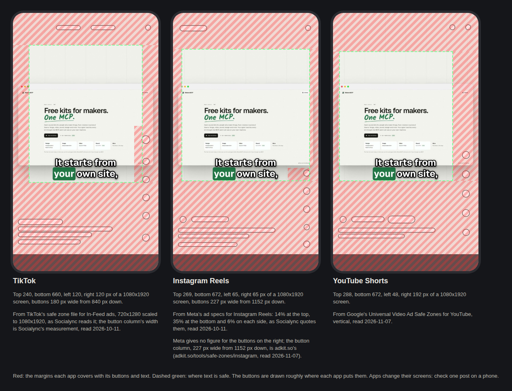

# easycaptionkit

Burn captions into a video in the product's own fonts and colors, word by word or line by line, kept clear of the buttons each app puts over a video. easycaptionkit also writes the SRT, VTT and ASS files to go with it.

```bash
npx easycaptionkit@latest demo.mp4 --words transcript.json --fonts easyfontkit-acme.com --brand easybrandkit-acme.com
```



Many people watch a feed with the sound off, so the words have to be on the picture. Caption tools draw them in a handful of looks of their own, know nothing of where an app's like button or the post's description will cover them, and often bring their own speech model. easycaptionkit takes the words from the files your tools already write, draws them in the fonts the product's site really uses, places them inside the space TikTok, Reels, Shorts, YouTube, X and LinkedIn leave free, and shows you a frame under each app's buttons so you can see it before you post.

The words and their times can come from a speech-to-text model, and [Wiro](https://wiro.ai/explore/speech-to-text) has several.

## What you get

```
easycaptionkit-demo/
  captioned.mp4            the video with the captions burned in, every frame and the sound kept
  captions.srt             the same captions as text, for places that take a captions file
  captions.vtt             the same in WebVTT, for the web's <track> and most players
  captions.ass             the same with the font, the colors and the place, for players that read ASS
  words.json               the words as read, with their times
  captions.json            every caption with its time in seconds and frames, the layout and the reading speed
  sheet.png                up to 24 captions on their frames, spread over the video
  safe-zones.png           a frame under each app's buttons, like the picture above
  CAPTIONS.md              what was made, where the captions sit and why, how fast they read, the font's license
  captioned.timeline.json  for a launch-film film: its timeline, so launch-film check finds the cuts
```

- Three styles: `karaoke` shows each caption whole and lights the word being spoken, `line` shows each caption whole in one color, `word` shows one word at a time, lit.
- With easyfontkit's `fonts.css`, the captions are drawn with the site's own font files, the ones in its folder, its heading font first. Chrome reports which font drew each letter, and CAPTIONS.md says so: a Japanese or Arabic caption over a Latin-only brand font is drawn partly in a system font, and the file tells you how much. A letter Chrome finds no font for on the machine is drawn as a box, as Japanese is on a server with no Japanese font; on Linux, where fontconfig can tell, CAPTIONS.md names those letters and says to install a font that has them, such as Noto Sans CJK, or to give `--fonts` an easyfontkit folder whose font has them.
- With an easybrandkit folder, the spoken word is lit in the brand's button, link or logo color. A color too dark to read as letters on the outline (a deep green, a navy) lights the word on a rounded patch of it instead. Without `--fonts` or `--font`, the brand's heading font is asked for by name, which this machine may not have; CAPTIONS.md says which font drew the letters wherever Chrome or fontconfig can tell.
- Captions are cut at sentence ends, commas and pauses, into at most two lines of what fits the safe width, up to 42 characters, by default (`--lines` and `--max-chars` change both), and held a little longer when they would flash by. In Japanese no caption or line starts with a particle or a small kana, or splits a word, when another break fits.
- The sound is copied as it is, so its loudness does not change. Sound that MP4 players do not take, like a camera's PCM in a MOV, becomes AAC at the same rate.
- Rotated phone videos are captioned upright, a video with pixels that are not square is made square first, an odd width or height loses its last row or column, and a variable frame rate keeps every frame at its own time. The captions show on the video's own frames, so where a video holds a frame for long, as a screen recording that writes a frame only when the picture changes does, has few frames a second, as a still picture over a podcast's sound can, starts after its sound or ends before it, captioned.mp4 is written at a steady rate instead, the video's own or a usual one such as 24 or 30 fps, each frame repeated until the next comes, and CAPTIONS.md says so. A caption that still shows on no frame is named there too.
- The captions run as long as the video's sound where the sound runs on past its picture, in the subtitle files too, and as long as its frames where it states no length, as a WebM a browser recorded does. A file whose frames and sound all end well before the length it states, as an interrupted download leaves it, is captioned as far as its frames go, and CAPTIONS.md says so.
- CAPTIONS.md carries the license facts easyfontkit read for the font that was burned in, and the closest free font when it is not open. Whether to use it is your call. When the font has none of the letters, as a Latin font has no Japanese, CAPTIONS.md says that no letter of it is in the video and names the fonts of the machine that drew them.

## Use it with your agent

easycaptionkit ships as an [Agent Skill](https://agentskills.io). Install it once and your agent runs it by itself when a video needs captions:

```bash
npx skills add EminBudak/easycaptionkit
```

That covers Claude Code, Codex, Cursor and the other agents the [`skills`](https://github.com/vercel-labs/skills) CLI supports. In Claude Code you can add it as a plugin instead:

```
/plugin marketplace add EminBudak/easycaptionkit
/plugin install easycaptionkit@easycaptionkit
```

In GitHub Copilot CLI it takes the same two steps:

```bash
copilot plugin marketplace add EminBudak/easycaptionkit
copilot plugin install easycaptionkit@easycaptionkit
```

Then ask as usual:

> Caption launch.mp4 for TikTok and Reels from transcript.json, in acme.com's fonts

The skill carries its own script, so it installs nothing else and needs no API key.

## Use it from the command line

```
npx easycaptionkit@latest <video> --words <file> [options]
npx easycaptionkit@latest subtitles <words> [options]
npx easycaptionkit@latest styles [--json]

  --words <file>      the words and their times (see below)
  --style <name>      karaoke, line or word (default: karaoke)
  --for <places>      tiktok, reels, shorts, youtube, x, linkedin or square, several
                      with commas (default: picked from the video's shape)
  --brand <dir|file>  an easybrandkit folder or its brand.json: the spoken word in its color,
                      and its heading font by name when there is no --fonts or --font
  --fonts <dir|file>  easyfontkit's folder or its fonts.css: the site's own font files
  --font <family>     the font family to use, from fonts.css or this machine
  --highlight <color> the color of the spoken word, like #ffd23f
  --position <where>  bottom, middle or top of the safe space (default: bottom)
  --lines <n>         lines a caption can take, 1 to 3 (default: 2)
  --max-chars <n>     characters a line can take, 8 to 80 (default: what fits, at most 42)
  --size <n>          letter size in percent of the phone's width or the frame's
                      short side, 2 to 20 (default: 6.5, or 9.5 for word)
  --box               a dark box behind the words instead of an outline
  --libass            draw with ffmpeg's libass instead of Chrome
  --out <dir>         where to save (default: ./easycaptionkit-<video name>, with
                      -2 and on when that holds another video's captions)
  --dry-run           check the options and say what would be made
  --json              print captions.json instead of a summary
```

easycaptionkit reads files, not addresses: a video or words given as `https://...` is refused, so download it first. `--brand` and `--fonts` take what easybrandkit and easyfontkit make from a site, so a site's address there is refused with words that name the kit to make it with.

`subtitles` writes captions.srt, captions.vtt and captions.ass from the words alone, with words.json, captions.json and CAPTIONS.md, and changes no video; `--video` gives it a video's size and length, and without it a demo's captions end where its steps.json says the video does. captions.ass is laid out for that frame, its lines cut to what fits across it at the letter size, so it can have more captions than captions.srt and captions.vtt, whose lines take up to 42 characters unless `--max-chars` gives another number. `styles` lists the styles, the options and every place's margins with their sources.

Without `--out`, a run goes to `easycaptionkit-<video name>`, or to `easycaptionkit-<video name>-2` and on when that folder holds the captions of another video by the same name, such as a second `demo.mp4`. A subtitles run goes to `easycaptionkit-subtitles-<video name>`, or `easycaptionkit-subtitles-<words name>` without `--video`, with `-2` and on in the same way. The name is the file's in lower case, its letters and digits in any script with a dash for anything else, and accents taken off Latin letters only; a name longer than 60 letters or 180 bytes is cut and ends in a short hash of the whole name. A run replaces the files an earlier run wrote in its folder, says so when that run was made from another file, and leaves anything else there alone. Each run's captions.json and words.json name the other files it wrote, with their sizes and SHA-256. A run stops before any work when the folder holds a file by one of the names it writes that they do not name, or that has changed since, such as another tool's words.json, a sheet.png of your own or a link, or one of the files the run reads, and says to pick another `--out`. A subtitles run also stops at a folder that holds the captioned video of an earlier run, which its new files would no longer match. The one file read and written over is a words.json from an earlier run, fixed by hand; if the edit breaks the JSON, the run says at which line and column. Once its words are fixed, a run that reads other words, such as the first command again, stops rather than replace them, and says how to keep them or start over. A file that comes in by one of the names while a run is going, or one there whose content changes, stays as it is: the run leaves the folder as it was and puts its own files in `easycaptionkit-new` inside it.

Some runs:

```bash
npx easycaptionkit@latest reel.mp4 --words words.json --for tiktok,reels,shorts
npx easycaptionkit@latest film.mp4 --words captions.srt --style line --box --for youtube
npx easycaptionkit@latest demo.mp4 --words steps.json --fonts easyfontkit-acme.com --style word
npx easycaptionkit@latest subtitles transcript.json --video film.mp4
```

Installed globally (`npm install -g easycaptionkit`), the command is `easycaptionkit`. npx keeps the copy an earlier run fetched, so `npx easycaptionkit@latest` is how you get a newer version.

It needs Node 22 or newer, ffmpeg 4.4 or newer and Chrome, Chromium, Edge or Brave. `brew install ffmpeg` and `winget install ffmpeg` give a new enough ffmpeg, and so does `sudo apt install ffmpeg` on Ubuntu 22.04, Debian 12 or newer; the tests run on Ubuntu 22.04's ffmpeg 4.4 and on the latest Ubuntu's, before every release too. Set `FFMPEG_PATH` and `CHROME_PATH` to pick them, as a path or a name on your PATH, and `FFPROBE_PATH` for an ffprobe that is not next to ffmpeg or on your PATH. There are no npm dependencies, and nothing leaves your machine: the browser runs offline with the font files on your disk.

## Where the words come from

`--words` takes the words with their times from any of these, told apart by what is in the file, saved as UTF-8 or UTF-16:

- speech-to-text JSON with word times: OpenAI's `verbose_json`, whisper.cpp (`-ojf`, or `-oj` with `-ml 1`), WhisperX and faster-whisper, ElevenLabs, Deepgram, AssemblyAI, NeMo, Parakeet, Hugging Face transformers' `chunks`, AWS Transcribe and Google Speech-to-Text. OpenAI sends its words without punctuation, so each takes its punctuation and letter case from the text OpenAI sends with them, and captions still end where sentences do. whisper.cpp's `-ml 1` cuts a rare word into pieces and puts punctuation on its own; they are read back as one word
- speech-to-text JSON with times for whole lines, such as whisper.cpp's `-oj`: each line's time is spread over its words by their length
- an SRT or WebVTT file, such as the captions a voice-over tool writes from its script; each cue's time is spread over its words by their length, and YouTube's automatic captions keep the word times they carry. As SRT, those captions repeat each line in the next cue; each line is read once, and CAPTIONS.md counts the lines left out. A file is read that way only when it shows that pattern, cues of a few milliseconds that repeat the line before or nearly every cue starting with it, so a film's dialogue keeps every line. A cue still up when the next comes on ends there, so the words of two cues never mix
- easyscreenshotkit's `steps.json`, for a demo with no voice: each step's note shows while the step plays
- a plain list of `{ "text", "start", "end" }`, or the `words.json` this kit wrote, so a misheard word can be fixed there and the run made again

## Where the captions go

The captions sit inside the space every place you name leaves free, centered, at the bottom of that space unless you pick `--position middle` or `top`. Several places give one file that is safe on all of them. A video of another shape is fitted into a phone's screen the way the app shows it, so a 16:9 clip posted to TikTok gets captions big enough for a phone.

| Place | Margins | From |
| --- | --- | --- |
| tiktok | 240 top, 660 bottom, 120 at the sides of 1080x1920; the buttons take 180 from 840 down | TikTok's safe zone file for In-Feed ads, as [Socialync](https://www.socialync.io/tools/safe-zones/tiktok) reads it (read 2026-10-11) |
| reels | 14% top, 35% bottom, 6% at the sides; the buttons take 227 from 1152 down | Meta's ad specs for Instagram Reels, as [Socialync](https://www.socialync.io/tools/safe-zones/instagram-reels) quotes them (read 2026-10-11); the button column is [adkit.so](https://adkit.so/tools/safe-zones/instagram)'s figure (read 2026-11-07) |
| shorts | 288 top, 672 bottom, 48 left, 192 right of 1080x1920 | Google's [Universal Video Ad Safe Zones](https://services.google.com/fh/files/misc/universalsafezones-youtube.pdf) (read 2026-11-07) |
| youtube | 166 top, 143 bottom, 152 at the sides of 1920x1080 | the same Google file, horizontal; its square layout for square videos |
| x | 7% top, 12% bottom, 5% at the sides of a 16:9 frame | an estimate from X's player; [adkit.so](https://adkit.so/tools/safe-zones/x)'s figures for square and vertical video |
| linkedin | 7% top, 12% bottom, 5% at the sides of a 16:9 frame | an estimate from LinkedIn's player; LinkedIn's guide for vertical video as [adkit.so](https://adkit.so/tools/safe-zones/linkedin) reads it |
| square | 80 on every side of 1080x1080 | adkit.so's figures for square posts |

Only ads have published margins, and apps move their buttons. Each figure carries its source and the day it was read, and safe-zones.png draws them over your own frame. Check one post on a phone before you post many.

## How it works

1. Reads the words, cleans their times (a word with none goes between its neighbors) and cuts them into captions by dynamic programming: a caption ends best at a sentence end, then at a comma or a pause, and worst inside a phrase. Lines are broken where they balance, with Intl.Segmenter for scripts written without spaces.
2. Works out each place's margins in the video's own pixels, the size of the letters for the screen the video plays on, and how many characters fit across.
3. Chrome draws every state of the captions once, on a see-through page the size of the video, in the brand's font files: a caption, or a caption with one word lit. Each state is a PNG of the band the captions sit in.
4. The PNGs go into one animated PNG, each for exactly as long as its state lasts, to the millisecond. ffmpeg reads it as one stream and lays it over the video in a single encode, H.264 with x264 at CRF 18 where ffmpeg has x264, with every frame at its own time, or at a steady rate where the video has too few frames for the captions, as above. On an SDR video the caption colors are converted with the video's own color matrix, so a brand color lands on the same color. A picture stored as RGB, as PNG or QuickTime Animation in a MOV is, or coded in YCgCo, is converted to the matrix players take for its size first, and captioned.mp4 names the matrix it holds.
5. Writes the subtitle files, takes frames of up to 24 captions from the result for sheet.png, draws safe-zones.png, and moves everything into the folder at once. A run that fails, or is stopped, leaves the folder as it was. A run killed outright (`kill -9`, or the system when memory runs out) cannot tidy up: its hidden `.easycaptionkit-work-` folder stays in the out folder, where an ffmpeg it started can go on writing captioned.mp4 to the end, and the Chrome profile it was drawing with stays in the temporary folder. The next run into that folder removes the work folder, and a later run of the same user that starts Chrome removes the profile once no process names it and it has not changed for a day, except on Windows, where it stays in the temporary folder until Windows or you clear it.

With `--libass`, ffmpeg draws the captions itself from captions.ass with its ass filter, and where Chrome is missing or cannot start, ffmpeg makes plainer pictures too, and CAPTIONS.md says why. That needs an ffmpeg built with libass, which Homebrew's default ffmpeg is not. The kit gives the ass filter libass's complex shaping, which joins Arabic letters and forms the conjuncts of Devanagari and Bengali as Chrome does. ffmpeg's subtitles filter shapes them simply and draws Arabic in a font without its presentation forms, such as Noto Kufi Arabic, as boxes, so to burn captions.ass yourself, use `ass=captions.ass:shaping=complex`. When its font comes from fonts.css, give libass the folder of that file too, easyfontkit's `files`, as `ass=captions.ass:fontsdir=../easyfontkit-acme.com/files:shaping=complex` does from the captions' folder, or libass draws another font in its place; CAPTIONS.md gives the folder. captions.ass names the video's color matrix and range in its YCbCr Matrix line, as TV.709 for most HD videos, so players and ffmpeg 8's ass filter convert its colors as the video's own; for a video in BT.2020's matrix, as HDR video is, one stored as RGB, and one in YCgCo or another matrix ASS has no name for, it says None, with which they take the video's matrix. Older ass filters, such as 4.4's, convert every color as BT.601 does, so the kit gives them the colors that come out as the video's own, and a full range picture in the one form they draw full range colors on, so its white is white; a color BT.601 cannot reach that way, such as a pure green on an HD video, is drawn as the nearest one it can, and CAPTIONS.md says so. libass lays every line out from the left unless the style's Encoding is -1, so captions in Arabic, Hebrew or another script written from the right have -1 there, and libass, like Chrome, takes each line's direction from its first letter, so a line of Arabic has its full stop at the left. libass finds a font file in the kit's folder by the family name in the file, which fonts.css can give otherwise (easyfontkit calls InterVariable Inter), so captions.ass names it as the file does. libass draws a variable font at its default weight rather than the bold, and CAPTIONS.md says so; a highlight too dark for letters becomes a thick border of that color instead of a patch. libass draws no color emoji either, so the video shows a box for an emoji this machine has no black and white font for, and for any letter no font on it has. CAPTIONS.md says which on Linux, where fontconfig can tell, with what to do, and elsewhere names the emoji as ones that can show as boxes. libass makes a font as tall as its OS/2 heights rather than its em, so captions.ass gives the font the size whose em is the letter size CAPTIONS.md names. libass measures no letters either, so a line whose width, added up from the widths of its letters in the font, puts it past the safe space is drawn smaller, and captions.ass draws it smaller the same way, as capitals often need. The heights and widths come from the font file where the kit knows it: the one fonts.css names, or on Linux the one fontconfig gives for the name. libass draws a letter that font lacks, as a Latin font lacks Japanese, with another font, sized by that font's own heights, so on Linux captions.ass sets such letters in the font fontconfig gives for them, and an Arabic letter in the first Arabic family Chrome is given that this machine has, such as Noto Sans Arabic, at the size that makes them as big as the others. Elsewhere the numbers are Arial Bold's, and a letter the font does not have is guessed, so such a line can still reach past the safe space. Where Chrome drew the captions, captions.ass takes the size Chrome measured. Without `--libass`, a run with no Chrome, or with one that cannot start here (in a container without its sandbox, say), stops before the encode and says so.

## Limits

- It does not listen. The words come from a speech-to-text model, a script or the steps of a demo; an SRT gives times for whole lines, so the lit word can be a little early or late.
- It does not look at the picture: a caption can land over text or a face the video already has. sheet.png shows up to 24 captions on their frames, captions.json has the time of every caption, and `--position` moves them.
- One look for now: white letters with a black outline or a dark box, the spoken word lit. More looks can come later.
- One file per run, safe on every place named. For a file per place, run once per place with `--out`.
- A run takes at most 100,000 words, some 10 hours of speech, of up to 500 characters each and a million in all. Caption a longer video in parts.
- Checking an existing subtitle file or someone else's captioned video (reading speed, line length, overlaps, captions under the buttons) is not in this version; CAPTIONS.md reports the reading speed of the captions it made.
- It does not read ASS files as words, and says so when given one. It does not show who is speaking.
- captioned.mp4 keeps the picture, each sound track with its language and the chapters. It leaves out the file's own tags, such as its title and where and when a phone recorded it, a cover picture, any other video, subtitle or data track, and the files attached to a Matroska file, such as fonts; CAPTIONS.md says which of them the video had.
- captioned.mp4 is H.264 in 4:2:0, 8-bit but for HDR, which every app takes: a video of more bits, of finer color, as 4:2:2 or 4:4:4, or stored as RGB, is written so, and CAPTIONS.md says what it was.
- HDR video stays HDR in 10 bits where ffmpeg's x264 can write them, with the captions' white at the reference white BT.2408 gives for graphics (75% of the signal for HLG, 58% for PQ) rather than the brightest the screen shows. Brand colors are not converted to BT.2020's colors, so on HDR they look stronger than on the site. Look at it on the phone it was shot with.
- It does not check whether you may use the font or the video. It tells you what easyfontkit found about the font.

## See also

- [easyfontkit](https://github.com/EminBudak/easyfontkit) saves the fonts a website really uses, with their licenses.
- [easybrandkit](https://github.com/EminBudak/easybrandkit) saves a site's real logo files, colors and fonts as a brand kit.
- [easyscreenshotkit](https://github.com/EminBudak/easyscreenshotkit) records a demo video of a site, with the steps.json captions can follow.
- [launch-film](https://github.com/EminBudak/launch-film) turns a site into a short launch film, and its `check` measures any video.
- [musicfit](https://github.com/EminBudak/musicfit) fits a music track to a video cut and ducks it under a voice.

## License

MIT
